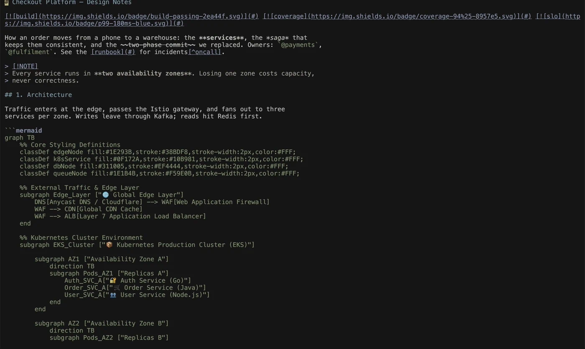
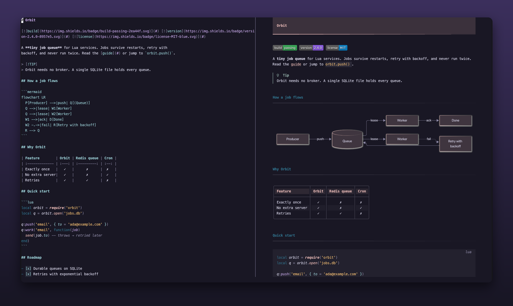
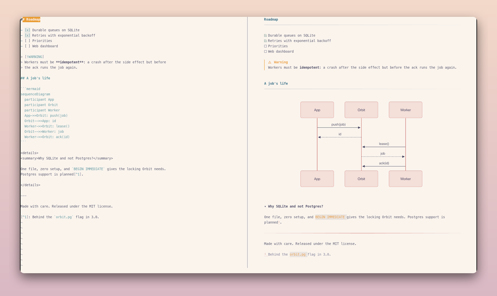
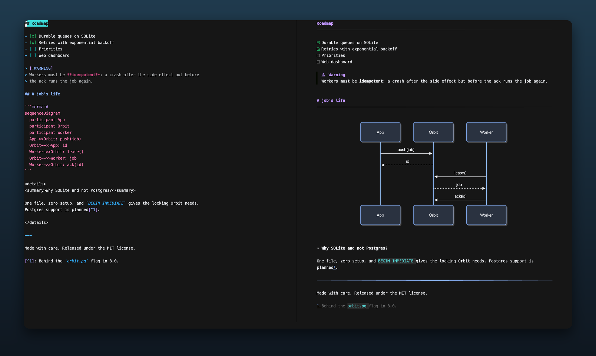

# vellum.nvim

A live markdown preview inside Neovim. It opens beside your buffer, in the terminal, and draws mermaid and D2 diagrams and math as real images.



- **Live.** Every keystroke re-renders. Only changed blocks are redrawn, so long documents stay fast.
- **Diagrams.** Mermaid and D2 render as images in your colorscheme's colors, sized to your font.
- **Math.** Inline `$…$` becomes Unicode text; display math renders with KaTeX.
- **Scroll sync, both ways.** The preview follows your cursor; scrolling the preview scrolls the source.
- **Zoom.** Open any diagram or image full-screen, then zoom and pan.
- **Follow links.** Web links, `#heading` links and links to other markdown files.
- **Export.** Write the document to PDF or HTML, diagrams and math included.
- **GitHub markdown and more.** Alerts, tables, task lists, footnotes, `<details>`, Obsidian callouts and wikilinks, MDX.



Colors follow your colorscheme, light or dark:

<p>
  
  
</p>

## Requirements

- Neovim 0.12 or newer, with `termguicolors`.
- Node.js 20 or newer, for diagrams, display math, non-PNG images and export.
- For images: [kitty](https://sw.kovidgoyal.net/kitty/) or [Ghostty](https://ghostty.org). Works over ssh. Elsewhere, diagrams show as code.
- In tmux, add:
  ```tmux
  set -g allow-passthrough on
  set -as terminal-features ',xterm-256color:RGB'   # your outer $TERM
  ```
- A [Nerd Font](https://www.nerdfonts.com), for alert and checkbox icons.

## Install

[lazy.nvim](https://github.com/folke/lazy.nvim):

```lua
{
  'blackhat-7/vellum.nvim',
  ft = 'markdown',
  keys = { { '<leader>mp', '<cmd>Vellum<cr>', desc = 'Markdown preview' } },
  opts = {},
}
```

lazy installs the renderer's node dependencies for you. It never downloads a browser: run `:Vellum build` once (and after updates) to install the small headless Chrome that diagrams need. With `chromium = false` that command installs no browser.

**Other plugin managers:** run `:Vellum build` once after installing, and again after updates.

**Nix:** the flake's `packages.<system>.plugin` has the renderer and a browser built in. Node must be on your `PATH`. With [nixvim](https://github.com/nix-community/nixvim), the module adds both:

```nix
imports = [ inputs.vellum.nixvimModules.default ];
```

Then check your setup with `:checkhealth vellum`. It checks the renderer and says what is missing.

## Use

| Command | What it does |
|---|---|
| `:Vellum` | Open or close the preview |
| `:Vellum export` | Write a PDF beside the file (HTML when `chromium = false`; `:Vellum export notes.html` for HTML) |
| `:Vellum build` | Install the renderer, and the browser when Chromium is on (Nix packages both) |

In the preview:

- `<CR>` or `gx` on a link follows it. `<CR>` on a diagram or image opens it full-screen.
- `q` closes the preview.
- With `tab = true`, `Tab` and `S-Tab` switch between the source and preview tabs.

Full-screen: `+` / `-` or Ctrl+wheel zoom, `hjkl` or the mouse pan, `0` fits, `q` closes.

To zoom from the markdown buffer, map `require('vellum').zoom()`:

```lua
vim.keymap.set('n', '<leader>mz', function() require('vellum').zoom() end)
```

## Configuration

The defaults:

```lua
require('vellum').setup({
  split = 'right',   -- where the preview opens: 'right', 'left', 'above' or 'below'
  size = nil,        -- its width or height in cells; nil for half
  tab = false,       -- true: open the preview in its own tab instead
  auto_open = false, -- true: open the preview whenever a markdown file is shown
  max_width = 100,   -- widest text column in the preview
  max_pixels = nil,  -- cap on pixels per rendered picture; nil for no cap
  chromium = true,   -- false: no browser; diagrams as code, math as text, images as alt text
})
```

A misspelled option is skipped with a warning.

**Colors.** The preview uses highlight groups named `Vellum*` (`:filter /^Vellum/ hi` lists them). Your own definitions win. Set them in a `ColorScheme` autocmd so they survive a colorscheme change:

```lua
vim.api.nvim_create_autocmd('ColorScheme', {
  callback = function() vim.api.nvim_set_hl(0, 'VellumH1', { fg = '#ff9e64', bold = true }) end,
})
```

**`max_pixels`.** Some terminal multiplexers drop large images without a word (herdr shows nothing above about 5.9 megapixels). Set `max_pixels = 5.5e6` there; big diagrams then render at a lower resolution.

## Diagrams

**Mermaid** renders with the same engine as GitHub, in a headless Chrome.

**D2** needs no extra command: the renderer draws it. If the [`d2`](https://d2lang.com) command is installed, it is used instead: a newer D2, with your layout plugins (like TALA) and `D2_*` settings.

- A diagram's own `vars: { d2-config: { ... } }` wins: `theme-id`, `theme-overrides`, `pad`, `sketch`, `layout-engine`.
- Icons can be URLs or files; file paths are relative to the markdown file.
- Markdown, LaTeX and code labels render.
- Only the main board is drawn; `layers`, `scenarios` and `steps` are not.

Each picture renders once and is cached on disk (up to 100 MB). The browser starts with the first picture that needs rendering, not when the preview opens.

With `chromium = false`, mermaid and D2 fences stay as code, display math becomes Unicode text, images show their alt text, and export writes HTML only. `:Vellum build` then installs no browser, and PDF export is refused. Run `:Vellum build` with `chromium = true` to install the browser again.

## What renders

| Markdown | In the preview |
|---|---|
| Headings | colored by level, H1 band, H2 rule |
| Bold, italic, strike, `code`, links, URLs | styled inline |
| Lists, task lists | bullets by depth, checkboxes |
| Quotes, `> [!NOTE]` alerts, Obsidian callouts | colored bar and title |
| Tables | aligned, wrapped to fit |
| Code blocks | syntax colors, language label |
| ` ```mermaid `, ` ```d2 ` | image (code outside kitty and Ghostty) |
| `$…$`, `$$…$$`, ` ```math ` | Unicode text inline; KaTeX image for display math |
| Images: PNG, JPG, GIF, WebP, SVG, local or web | image (alt text elsewhere) |
| Footnotes | superscript refs, notes at the end |
| `==highlight==`, `[[wikilinks]]` | marked text, links you can follow |
| Front matter, HTML, `<details>` | shown as text; comments hidden; details open |
| MDX (`.mdx`) | as markdown; `import`/`export` and `{/* comments */}` hidden |

## Contributing

See [CONTRIBUTING.md](CONTRIBUTING.md).

## License

MIT
